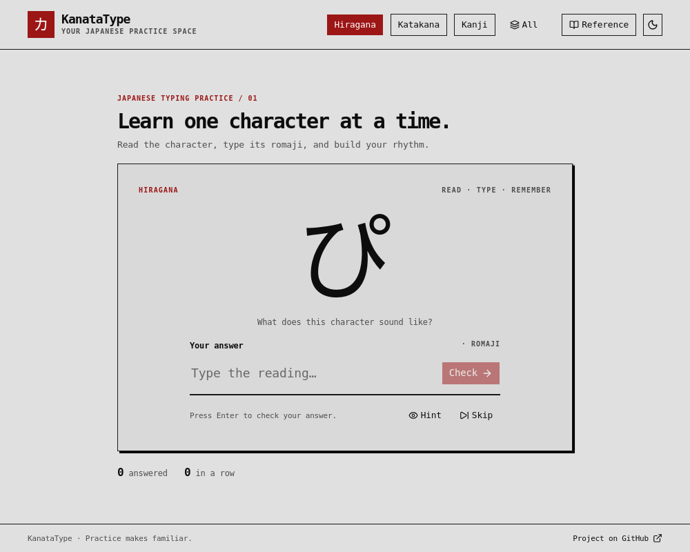

# KanataType

A clean, focused desktop app for learning and practicing Japanese kana (Hiragana & Katakana) and Kanji.

Built with **Tauri** for a lightweight, native-feeling experience.

---

## Preview



---

## Features

- **Multiple Script Modes**: Practice Hiragana, Katakana, Kanji — individually or combined
- **Smart Filtering**: Toggle any combination of scripts (always at least one active)
- **Interactive Learning**: Type a romaji reading for kana or the curated kanji prompts; choose JLPT-aligned kanji mode to type an English or Portuguese dictionary meaning, according to the selected app language. Hints, skips, counts, and streaks work in both modes
- **Level Selection**: Practice N5 through N1 kanji by introduction level or cumulatively (for example, Through N3 includes N5 + N4 + N3); kana toggles remain independent
- **Reference Table**: Search the full kana and kanji library by character, reading, meaning, or N-level; progressively show more results
- **Dark/Light Theme**: Built-in theme switcher that follows the system by default
- **Responsive UI**: Keyboard-accessible React + TypeScript interface
- **English / Brazilian Portuguese**: Switch languages on either screen; the choice persists, and Portuguese meaning prompts accept Portuguese answers instead of English ones

---

## Technologies

This application is built with **Tauri 2** — a secure and lightweight framework for desktop applications.

- **Backend**: Rust  
  High performance, memory safety, and native system integration
- **Frontend**: React + TypeScript + Vite  
  Modern, type-safe, and fast development experience

---

## Installation

### From Releases (Recommended)

Go to the [Releases](https://github.com/Rodrigo-Matuz/kanatype/releases/) page for Windows and x86_64 Linux downloads. For other platforms, build from source.

### NixOS / Home Manager (x86_64 Linux)

Add the input to your existing `flake.nix`:

```nix
inputs.kanatype.url = "github:Rodrigo-Matuz/kanatype";
```

Then import and enable its module in your Home Manager configuration:

```nix
{ inputs, ... }: {
  imports = [ inputs.kanatype.homeManagerModules.default ];
  programs.kanatype.enable = true;
}
```

For a standalone Home Manager flake, pass `inputs` with
`home-manager.lib.homeManagerConfiguration { extraSpecialArgs = { inherit inputs; }; ... }`.
For NixOS with Home Manager as a module, set
`home-manager.extraSpecialArgs = { inherit inputs; };` instead.
Then apply your usual Home Manager or NixOS configuration. The package installs
`kanatype` and a desktop launcher. Alternatively, install just the package with
`nix profile install github:Rodrigo-Matuz/kanatype` (do not install it both ways).

The flake packages the published **1.3.0** Linux `.deb` for x86_64, including
the offline JLPT-aligned study curriculum and Brazilian Portuguese. It fetches a pinned release
artifact, not a build of your local working tree. To receive a newer release,
update the flake input after its version and verified asset hash are updated.

### Build from Source

<details>
<summary>Build instructions</summary>

1. **Clone the repository**
   ```bash
   git clone https://github.com/Rodrigo-Matuz/kanatype.git
   cd kanatype
   ```

2. **Install frontend dependencies**

   ```bash
   bun install
   # or
   npm install
   ```

3. **Build the desktop app**

   ```bash
   bun run tauri build
   # or
   npm run tauri build
   ```

The built executable will be available in:

```
src-tauri/target/release/
```

</details>

---

## Run Locally (Browser Mode)

<details>
<summary>Start the browser preview</summary>

If you don’t want to build the desktop app, you can run it directly in your browser for development:

```bash
bun run dev
# or
npm run dev
```

Then open:

```
http://localhost:1420 (most likely)
```

This mode is ideal for faster development and testing UI changes.

Run the frontend checks with `bun test` and `bun run build`.
</details>

---

## Permissions & Security

KanataType follows **Tauri 2**'s strict capability-based permission model and only requests the minimum permissions needed.

You can inspect all permissions in:
```json
src-tauri/capabilities/default.json
```

---

## Customizing Datasets

You can easily modify the character datasets (Hiragana, Katakana, and Kanji) to suit your learning needs.

For detailed information about the current datasets and how to customize them, see:

→ **[src/data/README.md](src/data/README.md)**

This document includes explanations about small characters, yōon combinations, design decisions, and instructions for adding or removing characters.

### JLPT-aligned kanji curriculum (on `main`)

An offline, generated **unofficial** kanji study corpus is available at `src/data/jlpt/curriculum.json`. Its 2,211 entries are grouped as N5 (79), N4 (166), N3 (367), N2 (367), and N1 (1,232). Regenerate it from the pinned bundled sources with `bun scripts/generate-jlpt.ts`. See [data sources, checksums, transformations and attribution](docs/DATA_SOURCES.md) and the [implementation plan](docs/JLPT_PLAN.md).

Select Kanji, then choose **JLPT-aligned meanings**, a level, and **Through N…** or **N… only**. English mode covers all 2,211 entries. Portuguese mode offers meaning questions for the 1,929 entries with Portuguese KANJIDIC2 glosses (all N5–N2 entries and 950 N1 entries); the other 282 remain browsable in the reference with an untranslated label, not English-only practice questions. Kana and the existing 140 curated romaji-reading questions are unchanged in both languages. Dictionary-meaning answers and searches ignore accents (so `ideia` matches `idéia`), while romaji spelling remains strict. These sets do **not** teach every character's reading in context. The [JLPT does not publish an official post-2010 kanji list](https://www.jlpt.jp/e/faq/index.html#anchor28); these levels are approximate study groupings, not exam requirements or a measure of readiness. The 1.3.0 installers and the release-pinned opt-in Nix flake include Portuguese.

### Help translate

Interface strings live in [`src/i18n/en.json`](src/i18n/en.json) and [`src/i18n/pt-BR.json`](src/i18n/pt-BR.json). Edit a catalog using the same dotted keys and `{placeholders}` as English; run `bun run check:translations`, `bun test`, and `bun run build`. For a **new locale**, add its JSON catalog, register it in `src/i18n/translation.ts`, include it in the language selector in `src/components/Header.tsx`, and provide vetted locale-specific kanji meanings before enabling meaning practice in that language. Meaning answers are **data**, not interface strings: the Portuguese meanings in `src/data/jlpt/pt-meanings.json` are reproducibly extracted from the pinned KANJIDIC2 XML, and the JSON must retain its [data license and attribution](docs/DATA_SOURCES.md). Never translate romaji answer keys or auto-guess a single reading from dictionary metadata.

---

## TODO

- [ ] **Settings Page**
  - Themes and user preferences
  - In-app dataset editor (modify characters, add custom entries, etc.)

---

## Contributing

Contributions are welcome! Feel free to open issues or submit pull requests for:

- New features
- Contextual, editorially reviewed kanji reading and vocabulary prompts
- Bug fixes
- UI/UX improvements
- Translations

---

## Support the Project

If you find **KanataType** useful and want to support its development, consider [sponsoring me on Ko-fi](https://ko-fi.com/matuz).

Any amount is greatly appreciated!

---

## About

A simple and effective tool to help you learn Japanese characters.

Made with ❤️ by [Rodrigo Matuz](https://matuz.me)

---

**License**: [MIT](LICENSE) for application code. Bundled KANJIDIC2-derived curriculum metadata is adapted under [CC BY-SA 4.0](https://creativecommons.org/licenses/by-sa/4.0/), with separate upstream attribution and Tanos/KanjiAPI level-list credits in [Data Sources](docs/DATA_SOURCES.md). The MIT code licence does not cover that adapted metadata.
